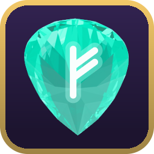
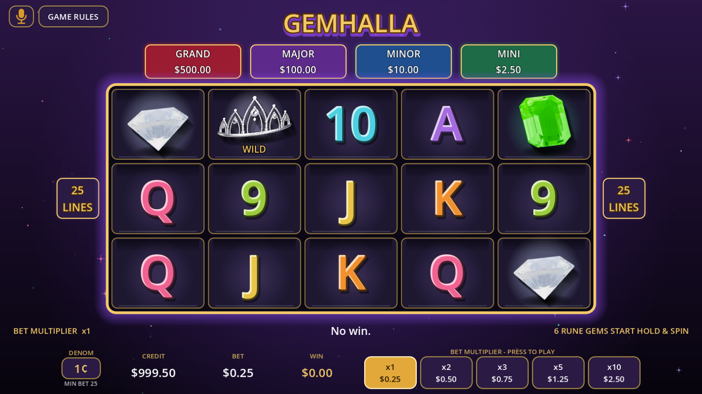
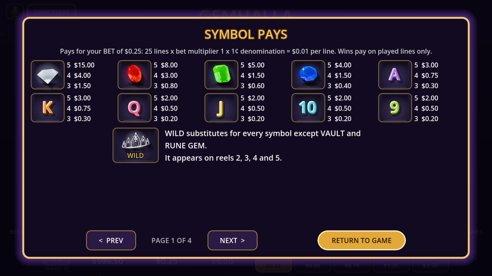

# Gemhalla: a gem-themed Hold & Spin slot machine in Godot 4



A 5x3, 25-line video slot with Hold & Spin, free games and four jackpots, built in Godot 4.7 (GDScript, Compatibility renderer). It runs in a browser or as a desktop game. **Play money only:** there is no real-money play, no purchase and no payout of any kind.

A small ASP.NET Core server (`server/`) can host the browser game for several players at once, with linked MAJOR and GRAND jackpots shared by everyone online, a timed challenge, and a password-protected admin page that watches every session live. Without the server, the game plays on its own and saves in the browser.

**[Play it in your browser](https://tekiesspace.github.io/GemhallaSlotMachine/)** (GitHub Pages, offline single-player).



## What's in the game

- **Line pays:** diamond, ruby, emerald and sapphire, then A down to 9. The **Wild** (a platinum and diamond tiara) appears on reels 2 to 5 and substitutes for everything except the Vault and the Rune Gem.
- **Free games:** 3 or more **Vaults** (an amethyst and diamond necklace) anywhere start 9, 15 or 20 free games, with line and scatter wins tripled. During free games, **Rune Storm** lightning turns some cells into Rune Gems.
- **Hold & Spin:** 6 or more **Rune Gems** lock in place for 3 respins; every new gem resets the count to 3. Gems carry credits or the MINI, MINOR or MAJOR jackpot, and filling all 15 cells adds the GRAND.
- **Jackpots:** MINI and MINOR are fixed. MAJOR and GRAND are progressive, and on the server every player feeds and can win the same two meters.
- **Cabinet-style betting:** the denomination picks the coin and the lines played; the bet buttons (x1 to x10) bet a multiple of the minimum *and spin*. Space repeats the bet and slams the reels.
- **GAME RULES:** a four-page paytable built from the math model, so it always matches it.
- **Art and sound made in code:** the gems are rendered, the tiara and necklace are modeled and rendered in 3D in Godot, and every sound is synthesized at startup. There are no audio files.

The math: RTP about 93.7% (40 million simulated games, including a 1% progressive feed), a hit about every 4.6 games, Hold & Spin about 1 in 91, free games about 1 in 266. See [docs/MATH.md](docs/MATH.md).



## Layout

| Path | What it is |
| --- | --- |
| `scripts/math/slot_config.gd` | The math model: reel strips, paytable, paylines, Hold & Spin and free-game tables. **All tuning happens here** |
| `scripts/math/slot_engine.gd` | Pure game logic (spin, evaluate, Hold & Spin, free games, forced outcomes). No visuals |
| `scripts/ui/` | The game screen: reels, win lines, paytable, challenge banner, fireworks, money display |
| `scripts/ui/gem_art.gd`, `assets/gems/` | Rendered gem images; winning gems spin through 16 rotation frames |
| `scripts/audio/` | Sound effects synthesized in code at startup. Edit the recipes in `sound_bank.gd` |
| `scripts/net/session_client.gd` | Connects the browser game to the server when the server served it; otherwise the game plays offline |
| `scenes/main.tscn` | The main scene |
| `server/` | ASP.NET Core server (.NET 10): hosts the browser build, the admin page (`wwwroot/admin`), sessions, linked jackpots and the timed challenge. See [docs/SERVER.md](docs/SERVER.md) |
| `tools/rtp_sim.gd` | Headless simulator that runs the real engine and reports RTP and feature rates |
| `tools/test_forced_outcomes.gd` | Checks every admin-forced outcome through the real engine |
| `tools/build_*.gd`, `render_kit.gd`, `make_icons.gd` | Rebuild the gem sheet, the 3D-rendered tiara and necklace, and the icons |
| `tools/*.ps1` | Windows helper scripts: export, serve, run the server or Docker, run the simulator, make desktop shortcuts |
| `Dockerfile`, `compose.yaml` | Container image for the server plus the browser build |
| `.github/workflows/build.yml` | Builds the game and the server; publishes GitHub Pages and Releases |
| `docs/` | Server and math documentation, and the README's images |
| `licenses/godot/` | Godot Engine's license and third-party notices, shipped with every exported build |

## Requirements

- [Godot 4.7](https://godotengine.org/download) (standard build, not .NET), to open, run and export the game. Exporting for the browser also needs Godot's export templates for the same version (in the editor: **Editor > Manage Export Templates > Download and Install**).
- [.NET 10 SDK](https://dotnet.microsoft.com/download), only for the multiplayer server.
- [Docker](https://docs.docker.com/get-docker/), only for the container.

The Windows helper scripts in `tools/` find Godot through the `-Godot` parameter, the `GODOT` environment variable, or `godot` on your PATH. On Windows, point them at the *console* build (`Godot_v4.7.2-stable_win64_console.exe`) so you see its output.

## Run it

Open the folder in Godot (**Import**, then pick `project.godot`) and press F5. Or from a terminal:

```bash
godot --path .
```

Credits, bet, unplayed free games and the jackpot meters save after every spin, to `user://gemhalla_save.cfg` (on Windows `%APPDATA%\Godot\app_userdata\Gemhalla\`, on Linux `~/.local/share/godot/app_userdata/Gemhalla/`; in the browser, the site's storage). Delete it to start fresh. New players start with $1,000, and running out refills you to $1,000.

| Key | Action |
| --- | --- |
| 1 to 5 | Bet x1, x2, x3, x5 or x10 the minimum, and spin |
| Space | Repeat the last bet; while the reels spin, slam them to a stop |
| Mouse | DENOM, the bet buttons, GAME RULES and the sound toggle |

## Play it in a browser

Export the "Web" preset (single-threaded, so it runs on any static web host with no special headers):

```bash
mkdir -p build/web
godot --headless --path . --import
godot --headless --path . --export-release "Web" build/web/index.html
```

Browsers won't run it from `file://`, so serve the folder:

```bash
python -m http.server 8060 --directory build/web
```

and open http://localhost:8060. On Windows, `tools/export_web.ps1` does both (and writes `build/gemhalla-web.zip` for upload to a game site); `tools/serve_web.ps1` serves an existing export again.

Served by any static host, the game plays offline, single-player.

The export contains the Godot engine, whose MIT license asks for its notice to go with every copy. If you publish a build, include `licenses/godot/LICENSE.txt` and `COPYRIGHT.txt` with it (`tools/export_web.ps1` and the GitHub workflow copy them in for you):

```bash
cp licenses/godot/LICENSE.txt build/web/GODOT-LICENSE.txt
cp licenses/godot/COPYRIGHT.txt build/web/GODOT-COPYRIGHT.txt
cp NOTICE.md build/web/
```

## Run the multiplayer server

```bash
godot --headless --path . --export-release "Web" build/web/index.html   # once, or after game changes
dotnet run --project server
```

- Game: http://localhost:8070/?session=alice. Each `session` name is its own player; leave it off and the game asks for a name.
- Admin page: http://localhost:8070/admin. Without an admin password it only answers from the same machine.

On Windows, `tools/run_server.ps1` exports when needed and runs it. The admin page, the timed challenge, the linked jackpots and every setting are in [docs/SERVER.md](docs/SERVER.md).

## Run it in a container

The image holds the server and the browser build. Godot isn't in the image, so export the game first (above), then:

```bash
docker build -t gemhalla .
docker run -d --name gemhalla -p 127.0.0.1:8070:8080 \
  -e AdminPassword='choose-a-long-password' \
  -v gemhalla-data:/data gemhalla
```

The game is at http://localhost:8070/?session=alice and the admin page at http://localhost:8070/admin. Sessions are kept in the `gemhalla-data` volume.

`compose.yaml` does the same with Docker Compose. It reads the password from a `.env` file next to it (`ADMIN_PASSWORD=...`), which `tools/run_docker.ps1` creates with a random password the first time. **`.env` is git-ignored; never commit it.**

To host it anywhere else, run the same image on any container host. Serve it over HTTPS (the game and admin page switch to secure WebSockets by themselves), set `AdminPassword` as a secret, keep `/data` on persistent storage, and run a single copy, because sessions are one file. See [docs/SERVER.md](docs/SERVER.md).

## Play it from GitHub

`.github/workflows/build.yml` runs on every push and pull request. It exports the browser game with Godot 4.7.2 on Linux and builds the server.

- **GitHub Pages:** each push to `main` publishes the browser game to https://tekiesspace.github.io/GemhallaSlotMachine/. A fork publishes to its own Pages site once Pages is switched on (**Settings > Pages > Source: GitHub Actions**).
- **Releases:** pushing a tag such as `v1.0.0` attaches the browser build as a zip to a GitHub Release. Unzip it and serve it from any static web host.
- **Artifacts:** every run keeps the browser build as a downloadable `gemhalla-web` artifact on its Actions page.

## Tools

Check the math with the headless simulator (it plays the real engine):

```bash
godot --headless --path . --script res://tools/rtp_sim.gd -- --spins=1000000 --seed=1
```

`--lines=5` plays 5 lines instead of 25. On Windows: `tools/run_sim.ps1 -Spins 1000000 -Seed 1`.

Check that every admin-forced outcome (big line win, free games, Hold & Spin, each jackpot) produces exactly what was asked:

```bash
godot --headless --path . --script res://tools/test_forced_outcomes.gd
```

Rebuild the art (the 3D renders need a window, so leave off `--headless`):

```bash
godot --path . --script res://tools/build_tiara.gd
godot --path . --script res://tools/build_necklace.gd
godot --headless --path . --script res://tools/make_icons.gd
```

`tools/build_gem_sheet.gd` rebuilds `assets/gems/gems_256.png` from the original CC0 sheet (see [NOTICE.md](NOTICE.md)). On Windows, `tools/make_shortcuts.ps1` puts shortcuts with Gemhalla's own icons on the desktop.

## Contributing

Issues and pull requests are welcome.

1. Fork the repository and make a branch.
2. Keep the game logic in `scripts/math/` free of visuals, and the math in `slot_config.gd`.
3. If you change the math, run `rtp_sim.gd` for at least a million games and put the RTP, hit frequency and feature rates in the pull request.
4. If you touch the engine or the server's forced outcomes, run `test_forced_outcomes.gd`.
5. Make sure the game still exports for the browser and the server still builds; the GitHub Actions workflow checks both on every pull request.

Never commit passwords, `.env` files or session data (`server/data/`). By contributing, you dedicate your contribution to the public domain under the same terms as the rest of the project ([LICENSE](LICENSE)).

## License

The code, art and sound made for Gemhalla are in the public domain ([LICENSE](LICENSE), the Unlicense). The gem images come from a CC0 sheet by KillGorack, and exported builds contain the Godot Engine (MIT); see [NOTICE.md](NOTICE.md) for what came from where.

Gemhalla is an original game. It uses common slot mechanics (Hold & Spin, free games, progressive jackpots) and no names, art or audio from any commercial slot machine. It is for entertainment with play money only.
